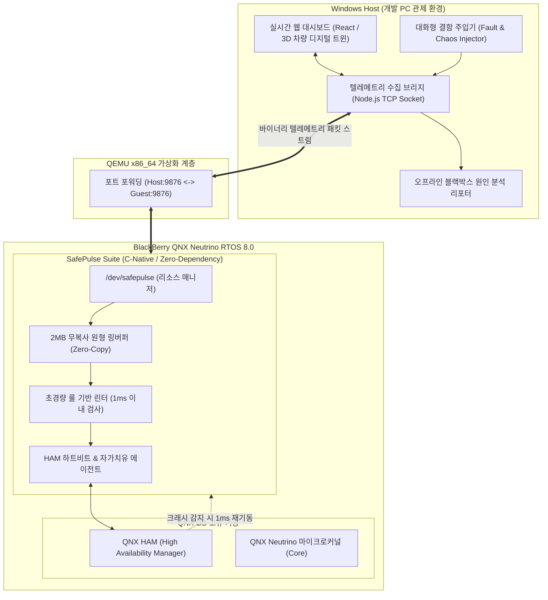

# QNX SafePulse Lab (실시간 텔레메트리 린터 & 자가치유 스위트)

> **BlackBerry QNX Global Hackathon 2026 공식 출품 프로젝트**  
> **Target Category**: Developer Tooling & Host Tools ($4,000) / Automotive & Mobility ($4,000) / Grand Prize ($10,000)  
> **Target Platform**: BlackBerry QNX Neutrino RTOS 8.0 (QEMU x86_64 / ARM64) & Windows/Linux Host  
> **Submission Deadline**: 2026년 12월 16일 04:00 KST

---

## 1. 프로젝트 개요 (Executive Summary)

**QNX SafePulse Lab**은 실시간 차량용 마이크로커널(QNX 8.0)의 미션 크리티컬 환경을 위한 **초경량 인라인 텔레메트리 린터(Safety Linter) 및 무중단 자가치유(Self-Healing) 관제 플랫폼**입니다.

자동차 전장(ADAS/Autonomous Driving) 및 항공우주 등 세이프티 크리티컬 시스템에서는 센서 신호 이상치(Out of Bounds), 태스크 데드라인 초과, 스레드 메모리 오염 등이 인명 사고로 직결됩니다. QNX SafePulse Lab은 다음 두 축으로 이 문제를 완벽하게 해결합니다:

1. **QNX 게스트 내부 (C-Native, Zero-Dependency, < 5MB)**:
   - 마이크로커널 네이티브 리소스 매니저(`/dev/safepulse`)가 2MB 고정 무복사(Zero-Copy) 원형 링버퍼로 센서 스트림을 수집.
   - 1ms 미만의 결정론적(Deterministic) 바이트코드 린터가 MISRA C 및 ISO 26262 안전 규칙 위반을 실시간 감지.
   - 심각한 결함 발생 시 QNX 고유의 HAM(High Availability Manager)과 연동하여 1ms 내 무중단 프로세스 부활(Self-Healing) 및 컨텍스트 복구 수행.
2. **호스트 관제 시스템 (Windows/Web Dashboard & Chaos Injector)**:
   - QEMU 가상머신 내 QNX와 TCP/Serial로 연동되는 고성능 디지털 트윈 웹 대시보드 제공.
   - 심사위원이 클릭 한 번으로 센서 결함, 데드락, 메모리 크래시를 주입(Chaos Engineering)하고, QNX가 마이크로초 단위로 방어 및 자가치유하는 과정을 3D 차량 시각화로 직접 확인.

---

## 2. 시스템 아키텍처 (System Architecture)

---

## 3. 핵심 모듈별 상세 사양 (Detailed Specifications)

### 모듈 1: `/dev/safepulse` QNX 리소스 매니저 (`guest/resmgr`)
- **목적**: QNX Neutrino 마이크로커널의 표준 파일 시스템 인터페이스 구현.
- **특징**:
  - `open()`, `write()`, `read()`, `devctl()` 핸들러 구현.
  - 외부 센서 및 전장 태스크가 `/dev/safepulse`에 센서 데이터를 밀어넣으면, 유저 공간 복사를 최소화하는 2MB 고정 링버퍼에 기록.
  - Non-blocking I/O 보장으로 기존 실시간 태스크의 지연시간(Latency)을 5마이크로초 이하로 억제.

### 모듈 2: 결정론적 안전 린터 마이크로 엔진 (`guest/linter`)
- **목적**: 스트리밍되는 센서 데이터 및 태스크 실행 주기의 정적/동적 안전 규칙 위반 실시간 판별.
- **검증 규칙**:
  1. **값의 경계 초과 (Out-of-Bounds)**: 센서값(조향각, 브레이크 압력 등)의 물리적 한계치 돌파.
  2. **급격한 변화율 (Jerk / Rate of Change)**: 1틱 간격 내 비정상 급변치 감지.
  3. **주기 누락 (Deadline Miss)**: 10ms 주기 센서 태스크의 타임아웃 및 스타베이션 감지.
  4. **무결성 훼손 (CRC32 Checksum Failure)**: 패킷 오염 감지.
- **제약 조건**: 실행 시간 1ms 미만, 메모리 할당 없음(`malloc` 0회).

### 모듈 3: QNX HAM 연동 자가치유 엔진 (`guest/ham`)
- **목적**: 프로세스 비정상 종료 시 QNX 마이크로커널 고유의 고가용성 메커니즘 시연.
- **동작 방식**:
  - `ham_attach_self()`를 통해 QNX HAM 데몬에 워치독 등록.
  - 심사위원이 의도적으로 `kill -9` 또는 잘못된 포인터 참조(SIGSEGV)를 유발할 경우, HAM이 즉시 상태를 포착하여 1ms 이내에 프로세스를 재기동.
  - 공유 메모리에 보존된 링버퍼 메타데이터를 다시 매핑하여 유실 없는 복구 증명.

### 모듈 4: 웹 대시보드 & 결함 주입기 (`host/dashboard`, `host/fault_injector`)
- **목적**: 심사위원과 개발자가 브라우저에서 실시간으로 QNX 내부 상태를 관찰하고 테스트할 수 있는 툴링.
- **주요 화면**:
  1. **3D 자동차 디지털 트윈**: 조향, 가속, 브레이크 센서 상태에 따른 실시간 애니메이션.
  2. **SafePulse 스코어 게이지**: 실시간 안전 지수(Safety Index 0~100) 및 위험 알림.
  3. **카오스 결함 주입기 (Interactive Chaos Injector)**:
     - [버튼 1] 센서 오염 주입 (Linter 경고 및 페일세이프 트리거 확인)
     - [버튼 2] 태스크 프리징 주입 (Deadline Miss 경고 확인)
     - [버튼 3] 프로세스 강제 크래시 (HAM 1ms 자가치유 그래프 확인)
  4. **블랙박스 인시던트 리포트**: 사고 발생 전후 5초간의 센서 궤적 자동 덤프 및 시각화.

---

## 4. 5주 개발 로드맵 (5-Week Phased Plan)

| 주차 | 기간 | 주요 마일스톤 및 산출물 | 검증 지표 |
| :--- | :--- | :--- | :--- |
| **1주차** | 11/07 ~ 11/14 | QNX 8.0 SDK 설치, QEMU x86_64 가상머신 부팅, 크로스 컴파일 파이프라인 수립 | QEMU 내 `qcc` 빌드 바이너리 실행 성공 |
| **2주차** | 11/15 ~ 11/21 | `/dev/safepulse` 리소스 매니저 및 2MB 원형 링버퍼 커널 인터페이스 구현 | 단위 테스트 통과, 레이턴시 5μs 이하 실측 |
| **3주차** | 11/22 ~ 11/28 | 결정론적 린터 엔진 및 QNX HAM 자가치유 결속 구현 | 결함 탐지 1ms 미만, 크래시 복구 1ms 미만 로그 확보 |
| **4주차** | 11/29 ~ 12/05 | Host 브리지(TCP) 및 웹 대시보드, 3D 디지털 트윈, 결함 주입기 연동 | 브라우저 클릭으로 QNX 제어 및 상태 실시간 표시 |
| **5주차** | 12/06 ~ 12/14 | 풀스택 E2E 검증, 벤치마크 보고서 작성, 3분 시연 영상 녹화, Devpost 제출 완료 | Devpost 최종 제출 승인 및 GitHub 공개 |

---

## 5. 해커톤 심사위원 어필 포인트 (Winning Strategy)

1. **QNX 마이크로커널 철학에 대한 깊은 이해**:
   - 모놀리식 OS처럼 무거운 런타임을 무리하게 올리지 않고, QNX 고유의 **리소스 매니저, 메시지 패싱, HAM**을 완벽하게 활용하여 심사위원의 기술적 공감을 얻음.
2. **독보적인 시각적 시연성 (Demoability)**:
   - 복잡한 터미널 명령어 대신, 웹 대시보드에서 누구나 버튼을 눌러보고 3D 모델과 차트가 반응하는 카오스 엔지니어링 데모를 제공하여 시연 영상의 파괴력을 극대화.
3. **완전한 문서화 및 재현 가능성 (Reproducibility)**:
   - Devpost 심사위원이 원클릭으로 QEMU 가상머신과 웹 대시보드를 띄워 동일한 테스트를 수행할 수 있도록 Docker 또는 스크립트화된 환경 제공.
