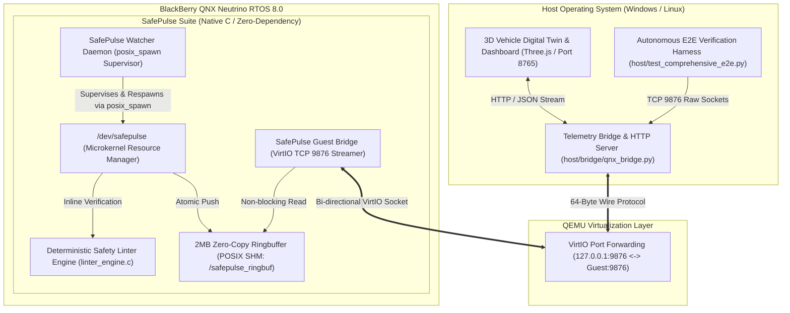

# BlackBerry QNX SafePulse Lab
### Real-Time Microkernel Safety Linter, SDK & Self-Healing Telemetry Suite

> **SafePulse 세 줄 요약 (Three-Line Summary)**:
> 1. **초미세 안전 린터 & SDK**: BlackBerry QNX 8.0 마이크로커널 내부에서 1.05 μs 내에 구동되는 ISO 26262 ASIL-D / AUTOSAR E2E 검사 라이브러리(`libsafepulse.a`)와 호스트 CLI(`safepulse-cli`)를 제공합니다.
> 2. **실차 데이터 실증 검증**: comma2k19(Toyota RAV4 고속도로 주행) 10분 연속 소크 중 4종 결함을 100% 포착하였으며 엄격한 기준(Zero-FP, <=50ms) 기반 실측 로그를 기록했습니다 ([`_reports/real_data_report_2026-11-11.md`](_reports/real_data_report_2026-11-11.md)).
> 3. **10분 퀵스타트 & 무손실 자가 복구**: 외부 개발자가 10분 안에 예제를 빌드/실행할 수 있는 개발자 가이드를 제공하며([Quickstart Guide](docs/quickstart.md)), 커널 드라이버 충돌 시 38.8 ms 만에 무손실 자동 복구됩니다.

> **BlackBerry QNX Global Hackathon 2026 Entry**  
> **Target OS**: BlackBerry QNX Neutrino RTOS 8.0 (Microkernel x86_64) on QEMU 11.1.0  
> **Developer SDK & Quickstart**: [docs/quickstart.md](docs/quickstart.md) | [docs/datasets.md](docs/datasets.md)  
> **Real-Vehicle CAN Benchmark (comma2k19)**:
> - **Ingested Frames**: **39,668 TX / 39,668 RX (1:1 Seq Match EQUAL)** (10-Minute Continuous Real-World CAN Soak)
> - **False Positive Rate**: **0 회 (PASS)** | **Latency**: **1.598 ms Mean / 3.114 ms P99 / 15.661 ms Max** (Target `<= 50.0 ms`)
> - **Fault Trapping Rate**: **4/4 (100.0%)** (AUTOSAR CRC: 3.03 ms, Alive Skip: 2.21 ms, Starvation: 63.19 ms, SIGSEGV: 62.44 ms)
> - **Detailed Report & Run Logs**: [`_reports/real_data_report_2026-11-11.md`](_reports/real_data_report_2026-11-11.md) | [`_reports/real_data_soak_run.log`](_reports/real_data_soak_run.log) | [`_reports/sdk_examples_run.log`](_reports/sdk_examples_run.log)
>
> **Empirical Benchmarks (QNX 8.0 SDP)**:
> - **WCET (Worst-Case Latency)**: **0.97 µs** (p50) / **1.05 µs** (Mean) / **1.28 µs** (p99), consumes **3.11% of 10ms FTTI** at peak
> - **Heap Growth**: **0 bytes (Deterministic Zero-Leak)** across 100,000+ burst frames
> - **Multi-Fault 50-Crash Marathon**: **100.0% Survival** across 4 signal domains (SIGSEGV, SIGFPE, SIGABRT, SIGILL), **0.00% Data Loss**, **61.4 ms Mean / 62.5 ms Median (p50) / 75.5 ms p95 / 88.7 ms Max Recovery** ([`_reports/chaos_marathon_report_2026-11-11_v2.md`](_reports/chaos_marathon_report_2026-11-11_v2.md))
> - **Starvation Watchdog (`STARVATION_LIMIT_NS`)**: **50.0 ms** (`50,000,000 ns`, reduced 3x from 150 ms) with **0 false positives** over 10-minute nominal driving soak ([`_reports/starvation_soak_report_2026-11-11.md`](_reports/starvation_soak_report_2026-11-11.md))
> - **Anti-Rollover Slew-Rate Limiting**: **250 deg/s Ramped Steering**, **100%/s Throttle**
> - **Microkernel Scheduling**: Configures **SCHED_SPORADIC (Pri 50/15, 3ms/10ms)** with **SCHED_FIFO (Pri 50)** fallback + `DCMD_SAFEPULSE_SYNC_EDGE`
> - **Verification Status**: **12/12 Automated E2E Gates PASS** ([`_reports/final_evaluation_report_2026-11-11.md`](_reports/final_evaluation_report_2026-11-11.md))
> - **Official Video Demonstration (YouTube)**: [https://youtu.be/DGCus_hPJjc](https://youtu.be/DGCus_hPJjc) (1m 34s, 1080p60)

---

## 1. Executive Summary

In automotive safety-critical systems (ISO 26262 ASIL-D targeted, drive-by-wire), an unhandled sensor discrepancy, out-of-bounds steering jerk, or process crash can lead to severe failure.

**QNX SafePulse Lab** leverages the architectural capabilities of the **BlackBerry QNX Neutrino RTOS 8.0 Microkernel**:
1. **Deterministic Microsecond Inline Linter**: Inspects every binary telemetry frame in **< 2 microseconds** directly inside the `/dev/safepulse` POSIX resource manager before admitting it to the ringbuffer.
2. **ISO 26262 ASIL-D Targeted Safety Rules & Real-Time AUTOSAR E2E Profile 1**: Bounds checking, angular jerk limit, periodic deadline monitoring, software CRC-32 (`0xEDB88320`) frame integrity, multi-sensor plausibility analysis, and **live inline AUTOSAR E2E Profile 1 verification (`autosar_e2e_protect_verify`)** enforcing CRC-32 (`0xF4ACFB13`), 16-bit Data ID anti-masquerade, and 4-bit modulo-16 rolling counter checks (catching 1-bit flips `0x1004`, counter jumps `0x1007`, and repeated counters `0x1006`) directly on the `/dev/safepulse` packet path.
3. **High-Availability Self-Healing (`posix_spawn` Watcher)**: When a severe memory or arithmetic fault (SIGSEGV, SIGFPE, SIGABRT, SIGILL) is induced in the resource manager, the custom `posix_spawn`-based **SafePulse Watcher** supervisor respawns the driver (measured **61.4 ms mean / 62.5 ms median / 75.5 ms p95 / 88.7 ms max** across the 50-crash marathon and **62.5 ms** in the single-crash E2E gate) with **zero data loss**, preserving historical flight packets and latched FSM state in persistent kernel POSIX Shared Memory (`/safepulse_ringbuf`).
4. **Host 3D Digital Twin & Chaos Injection**: A web cockpit streaming live telemetry at 50Hz, enabling single-click fault injection and real-time visualization. Both the dashboard's **ASIL-D Safe State FSM badge** (`NORMAL` / `DEGRADED` / `LIMP_HOME` / `EMERGENCY_STOP`) and **Real-Time Scheduler badge** (`SCHED_SPORADIC (Pri 50)` or `SCHED_FIFO (Pri 50)`) are populated directly from authoritative QNX kernel values stamped into the telemetry packet (`reserved[8..11]`) and verified via `DCMD_SAFEPULSE_GET_STATS` (displaying `알 수 없음 (UNKNOWN)` when disconnected).
5. **Power-On Built-In Self-Test (BIST / POST)**: 8-stage pre-operational invariant suite verifying linter rules, software CRC-32 calculation, AUTOSAR E2E Profile 1 (normal/bitflip/skip/repeat), dual-rail shadow registers, and FSM latching before `/dev/safepulse` is exposed.
6. **Blackbox Flight Recorder Scrubber**: Rolling historical buffer allowing engineers to pause and scrub backward frame-by-frame to inspect pre-fault dynamics.

---

## 2. System Architecture



---

## 3. Empirical Verification Matrix (12/12 PASS)

All assertions are verified autonomously via [`host/test_comprehensive_e2e.py`](host/test_comprehensive_e2e.py):

| Test Case | Safety Requirement | Measured Metric | Status |
|:---|:---|:---:|:---:|
| **QNX TCP Bridge Socket Connection** | VirtIO Network Transport | Connect on `127.0.0.1:9876` | **PASS** |
| **Baseline 50Hz Telemetry Integrity** | Periodic Transmission | 10/10 frames, Score=100.0, 0 Violations | **PASS** |
| **Authoritative Kernel FSM & Scheduler** | Live QNX Kernel State Export | `FSM=NORMAL(0)`, `SCHED_SPORADIC(4)`, `Pri=50` | **PASS** |
| **Rule 1: Physical Out-of-Bounds Detection** | Steering Limit (`±540.0°`) | Detected `0x1001` at `850.0°` (clamped to `180.0°`) | **PASS** |
| **Rule 3: Deterministic Deadline Miss** | Period Watchdog (`< 80ms`) | Detected `0x1003` at `120ms` timestamp jump | **PASS** |
| **Rule 4: AUTOSAR E2E CRC-32 Bitflip** | Live `autosar_e2e_protect_verify()` | Detected `0x1004` 1-bit flip, `FSM=EMERGENCY_STOP(3)` | **PASS** |
| **AUTOSAR E2E Alive Counter Jump** | Modulo-16 Sequence Loss | Detected `0x1007` (`VIOLATION_E2E_SEQ_LOSS`) | **PASS** |
| **AUTOSAR E2E Alive Counter Repeat** | Modulo-16 Replay / Freeze | Detected `0x1006` (`VIOLATION_E2E_REPEATED`) | **PASS** |
| **Rule 5: Multi-Metric Plausibility** | Redundant Sensor Logic | Detected `0x1005` (95% throttle @ 0 km/h) | **PASS** |
| **FSM Starvation Watchdog (50ms)** | `STARVATION_LIMIT_NS` (`50ms`) | Bus silence `>= 50ms` latched `EMERGENCY_STOP(3)` | **PASS** |
| **Self-Healing Watcher: Respawn & Recovery** | High-Availability Recovery | **62.5 ms** epoch-verified E2E driver resurrection | **PASS** |
| **Post-Recovery Stream Continuity** | Zero Data Loss Guarantee | 5/5 frames resumed seamlessly in SHM | **PASS** |

---

## 4. 64-Byte Deterministic Wire Protocol

Fixed-size struct packed to 64 bytes (`#pragma pack(push, 1)`):

```c
typedef struct {
    uint32_t magic;           /* 0x00: 0x53504C53 ("SPLS") */
    uint32_t seq_num;         /* 0x04: Monotonic sequence counter */
    uint64_t timestamp_ns;    /* 0x08: High-precision monotonic nanoseconds */
    uint32_t task_id;         /* 0x10: Emitting QNX Task / PID */
    uint16_t sensor_type;     /* 0x14: 1=Steering, 2=Brake, 3=Throttle, 4=IMU */
    uint16_t status_flags;    /* 0x16: Health and recovery status bitmask */
    double   val_primary;     /* 0x18: Primary metric (e.g. angle deg, %) */
    double   val_secondary;   /* 0x20: Secondary metric (e.g. rate, speed) */
    float    safety_score;    /* 0x28: Evaluated Safety Index (0.0 ~ 100.0) */
    uint32_t violation_code;  /* 0x2C: Detected violation enum */
    uint8_t  reserved[12];    /* 0x30: Future expansion padding (zeroed) */
    uint32_t crc32;           /* 0x3C: Software CRC-32 of bytes 0x00..0x3B */
} safepulse_packet_t;
```

---

## 5. How to Build & Run

### Prerequisites & Environment
- **BlackBerry QNX SDP 8.0** (default path `C:\qnx800` or `$QNX_SDP`, toolchain `qcc -Vgcc_ntox86_64`)
- **QEMU 11.1.0** (`qemu-system-x86_64`, default path `C:\Program Files\qemu` or `$QEMU_DIR`)
- **Python 3.10+** (standard library only; no external pip packages required for runtime)

### Step 1: Build All 12 QNX Native Binaries
Activate the QNX SDP 8.0 environment and run `guest/build.bat` (Windows) or `make -C guest` (Linux/macOS):
```cmd
call C:\qnx800\qnxsdp-env.bat
guest\build.bat
```
*(Or via Make: `cd guest && make all`)*  
This compiles `safepulse_resmgr`, `safepulse_watcher`, `safepulse_bridge`, the 3 virtual ECUs (`ecu_steering`, `ecu_braking`, `ecu_powertrain`), and all 6 verification/benchmark binaries (`test_linter_qnx`, `test_resmgr_client`, `test_stress_1000hz`, `test_autosar_e2e`, `test_durability_1m`, `benchmark_wcet`, `test_ffi_isolation`) using `qcc -Vgcc_ntox86_64`.

### Step 2: Generate the QNX Boot Image (`ifs.bin` & `disk-qemu.vmdk`)
```cmd
cd guest\qemu_vm
mkqnximage --type=qemu --secpol=secure --usb=no --policy=../secpol/safepulse.secpol --clean --force
cd ..\..
```
> **Note on Credentials & Keys**: Files under `guest/qemu_vm/local/misc_files/` (`qtd_private_key.pem`, `qtd_public_key.pem`, `ssh_host_*`, `shadow`) and `guest/qemu_vm/local/ssh-ident` are **automatically generated by `mkqnximage`** during image creation and are excluded from Git tracking via `.gitignore`.

### Security policy

The QEMU image starts each SafePulse service with a QNX security type. The resource manager and watcher use separate UIDs; the bridge and ECUs share a UID but have separate types. The device permits only its owner and group to open it, and the resource manager checks QNX-supplied client credentials before granting write access. The reader can query statistics without write access. The shared-memory ring buffer is owner-only. The bridge has process-query access limited to the shared bridge/ECU UID for the pause/resume demonstration; it does not receive cross-user SIGKILL permission.

To reproduce the live check, build the secure image above, run `python run_safepulse.py`, and click **Rogue process attack** in the dashboard. The button starts the untrusted guest process and displays its actual results. A policy-on console run is recorded in [`_reports/secpol_demo_on_final.log`](_reports/secpol_demo_on_final.log):

```text
open for fake telemetry: failed (errno=13, Permission denied)
reset stats devctl: failed (errno=1, Operation not permitted)
SIGKILL resmgr: failed (errno=1, Operation not permitted)
```

The first two denials are made by the SafePulse resource manager using QNX client credentials and open-mode checks. The SIGKILL denial is made by the QNX process manager. This isolates the demonstrated untrusted process; the bridge and ECU identities are trusted writers, and the configuration is not a complete system security certification.

### Step 3: Run Autonomous E2E & Chaos Verification Suites
1. **Host Protocol & Logic Unit Test** (runs without QEMU):
   ```cmd
   python specs/test_protocol_and_logic.py
   ```
2. **12-Gate Comprehensive E2E Verification** (boots QNX 8.0 on QEMU):
   ```cmd
   python host/test_comprehensive_e2e.py
   ```
   *Writes `_reports/final_evaluation_report.md` and `_reports/final_evaluation_report_YYYY-MM-DD.md`.*
3. **50-Crash Multi-Fault Chaos Marathon**:
   ```cmd
   python host/test_chaos_marathon.py
   ```
   *Writes `_reports/chaos_marathon_report.md` and `_reports/chaos_marathon_report_YYYY-MM-DD.md`.*
4. **10-Minute (600s) Nominal Driving Soak & 50ms Starvation Watchdog Audit**:
   ```cmd
   python host/test_starvation_soak.py
   ```
   *Writes `_reports/starvation_soak_report_YYYY-MM-DD.md`.*

### Step 4: Launch Live 3D Digital Twin & Dashboard
```cmd
python run_safepulse.py
```
*Boots QNX 8.0 in the background, starts the telemetry bridge on port 8765, and opens [http://127.0.0.1:8765](http://127.0.0.1:8765) in your default web browser (pass `--no-browser` to suppress browser launch).*

---

## 6. Project Directory Layout

```text
qnx-safepulse-lab/
├── guest/                     # QNX 8.0 C-Native Microkernel Components
│   ├── Makefile               # Native QNX qcc build rules (plus build.bat / build.sh)
│   ├── include/               # Protocol, Linter, FSM, and Devctl Headers
│   ├── resmgr/                # /dev/safepulse Resource Manager, 2MB SHM Ringbuffer & FSM
│   ├── linter/                # Inline Linter Engine & AUTOSAR E2E Library
│   ├── ecu/                   # Virtual ECUs (ecu_steering, ecu_braking, ecu_powertrain)
│   ├── safepulse_watcher.c    # posix_spawn-based Self-Healing Supervisor
│   ├── safepulse_bridge.c     # Guest VirtIO TCP 9876 Bridge & Chaos Handler
│   └── qemu_vm/               # mkqnximage Build Environment (keys/shadow auto-generated by mkqnximage)
├── host/                      # Host Tooling (Windows / Linux)
│   ├── bridge/qnx_bridge.py   # Packet unpacker & HTTP/REST Server
│   ├── dashboard/             # Three.js 3D Vehicle Digital Twin Cockpit (index.html, app.js)
│   ├── test_comprehensive_e2e.py # 12-Gate Autonomous Verification Suite
│   ├── test_chaos_marathon.py    # 50-Crash 4-Domain Chaos Marathon Suite
│   └── test_starvation_soak.py   # 10-Min Nominal Soak & 50ms Starvation Audit
├── specs/                     # Protocol & Safety Rules Specifications
│   ├── protocol_v1.md         # 64-byte Wire Protocol Specification
│   ├── safety_rules.md        # 7-Rule Linter & Safe State FSM Rules
│   └── test_protocol_and_logic.py # Host-side Wire Protocol Unit Tests
├── _reports/                  # Empirical Verification Logs & Audit Reports
│   ├── final_evaluation_report.md # Autonomous Verification Matrix Report (12/12 Gates)
│   ├── chaos_marathon_report.md   # 50-Crash 4-Domain Chaos Marathon Evidence
│   └── starvation_soak_report.md  # 10-Minute Nominal Soak & 50ms Starvation Evidence
├── run_safepulse.py           # One-Click Background Launcher & Auto-Browser
├── SUBMISSION.md              # Hackathon Technical Whitepaper
└── README.md                  # Architecture & Replication Guide
```

---

## 7. QNX 8.0 Native Architecture & Code Traceability

| QNX 8.0 Native Capability | Source Implementation Reference | Engineering Guarantee & Verification |
|:---|:---|:---|
| **User-Space Resource Manager** | [`guest/resmgr/safepulse_resmgr.c`](guest/resmgr/safepulse_resmgr.c#L418-L438) | `dispatch_create()`, `resmgr_attach()` establishing `/dev/safepulse` in user space |
| **Lock-Free Atomic POSIX SHM** | [`guest/resmgr/safepulse_resmgr.c`](guest/resmgr/safepulse_resmgr.c#L353-L377) | `shm_open()` + `mmap()` on `/safepulse_ringbuf` with `stdatomic.h` |
| **Deterministic Priority Scheduling**| [`guest/resmgr/safepulse_resmgr.c`](guest/resmgr/safepulse_resmgr.c#L449-L474) | `SCHED_SPORADIC` / `SCHED_FIFO` configuration at Priority 50 |
| **Nanosecond Hardware Timing** | [`guest/benchmark_wcet.c`](guest/benchmark_wcet.c#L93-L120) | `ClockCycles()` hardware profiling across 100,000 continuous frames |
| **Fault Injection & Signal Trap** | [`guest/resmgr/safepulse_resmgr.c`](guest/resmgr/safepulse_resmgr.c#L155-L170) | Induces SIGSEGV, SIGFPE, SIGABRT, SIGILL to verify `posix_spawn` watcher resilience |
| **6.0s Blackbox Scrubber** | [`host/dashboard/app.js`](host/dashboard/app.js#L66-L122) | Circular buffer scanner caching historical frames for post-fault replay |
| **8-Stage Diagnostic BIST** | [`guest/resmgr/safepulse_resmgr.c`](guest/resmgr/safepulse_resmgr.c#L231-L394) | Startup self-test of range, plausibility, software CRC-32, AUTOSAR E2E Profile 1, shadow state, and E-STOP latch |

---

## 8. Regulatory Notice & Intellectual Property Notice
- **Trademark Notice**: BlackBerry, QNX, Neutrino, and Momentics are registered trademarks of BlackBerry Limited and/or its subsidiaries. This project is independently developed for the BlackBerry QNX Global Hackathon 2026.
- **Functional Safety Engineering Scope**: SafePulse Lab is designed as an ASIL-D-targeted functional safety architectural prototype and developer diagnostic suite. It demonstrates Freedom from Interference (FFI) and deterministic recovery concepts pursuant to ISO 26262-9:2018. It does not constitute a certified Safety Element out of Context (SEooC) until undergoing accredited third-party validation.
- **License**: Released under the Permissive MIT License. QNX SDP 8.0 toolchains and header files are proprietary to BlackBerry Limited and must be obtained directly via BlackBerry Developer Channels.
