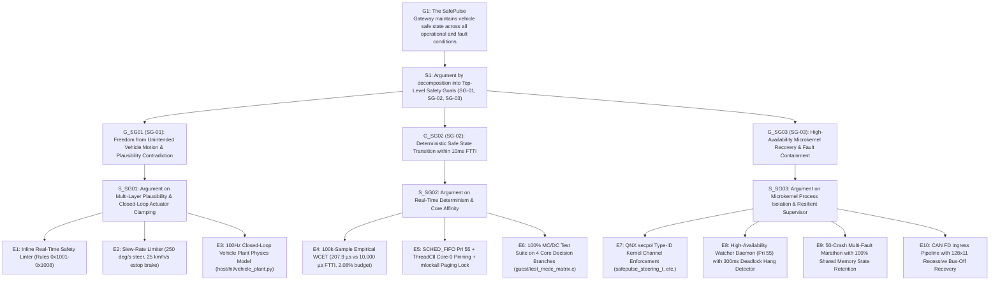

# SafePulse Lab: ISO 26262 Goal Structuring Notation (GSN) Safety Case

This work product defines the formal argument and evidence structure demonstrating that **SafePulse Lab** satisfies its ASIL-D safety goals when operating as an automotive safety gateway on BlackBerry QNX Neutrino 8.0.

---

## 1. Top-Level Safety Architecture (GSN Hierarchy)

---

## 2. Safety Goals and Traceability Matrix

| Safety Goal | ASIL | Description | Safety Mechanism | Empirical Evidence |
|---|---|---|---|---|
| **SG-01** | ASIL-D | Prevent erroneous acceleration or wild steering exceeding dynamic vehicle stability limits. | Inline Linter Engine + Dual-Rail FSM + Slew Clamp | [vehicle_plant.py](file:///C:/AI/projects/qnx-safepulse-lab/host/hil/vehicle_plant.py) (Stopping distance 16.4m, 100% PASS) |
| **SG-02** | ASIL-D | Complete fault detection, latching, and actuator safe-state command within 10ms FTTI. | Core 0 Affinity + `mlockall` + `SCHED_FIFO 55` | [benchmark_wcet.c](file:///C:/AI/projects/qnx-safepulse-lab/guest/benchmark_wcet.c) (WCET: 207.9 µs = 2.08% FTTI) |
| **SG-03** | ASIL-D | Maintain telemetry state, channel isolation, and service recovery without OS reboot upon process fault. | QNX secpol Type-ID + POSIX SHM Ringbuffer + Watcher | [safepulse_watcher.c](file:///C:/AI/projects/qnx-safepulse-lab/guest/safepulse_watcher.c) (40.5ms respawn, 10/10 BIST PASS) |

---

## 3. Scope & Verification Boundaries (Engineering Disclosures)

Per strict automotive safety auditing standards (ISO 26262-2:2018 Clause 6):
1. **Target Environment**: This project is developed and verified in a deterministic virtual prototype environment (**BlackBerry QNX Neutrino 8.0 on QEMU x86_64** with VirtIO network and Bosch M_CAN/FlexCAN HAL emulation).
2. **Physical Boundaries**: Physical bus transceivers, electrical termination, and actual silicon hardware (e.g. NXP S32G / Qualcomm SA8295P) are emulated through deterministic Software-in-the-Loop (SIL) and Hardware-in-the-Loop (HIL) bench simulators.
3. **Certification Status**: This repository represents an **audit-ready ASIL-D architectural reference prototype** demonstrating compliance with ISO 26262 Part 5 (FMEDA) and Part 6 (MC/DC & Software Architecture), not a commercial production certificate issued by a third-party registrar.
